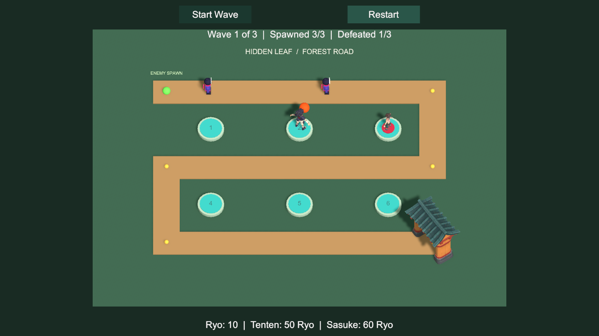
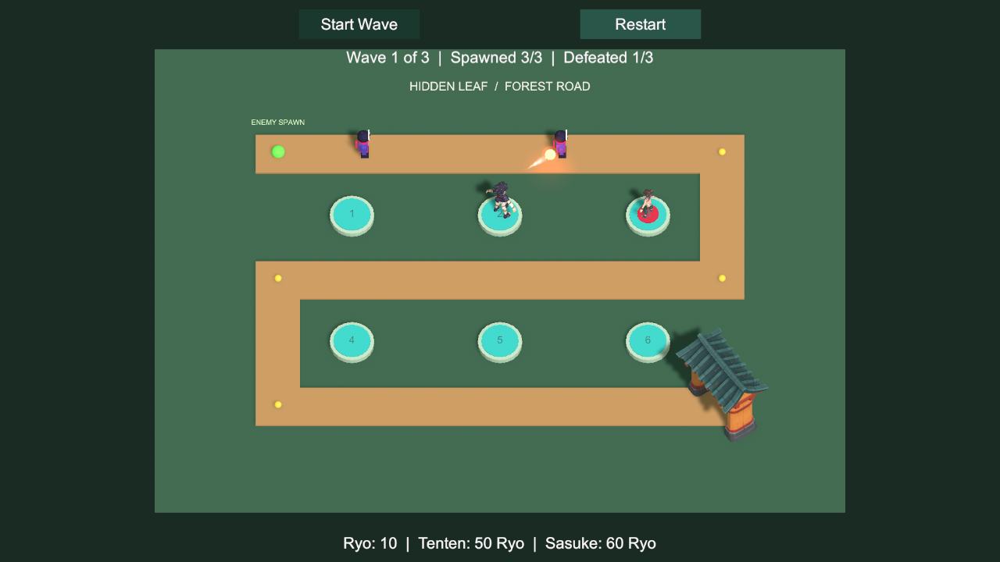
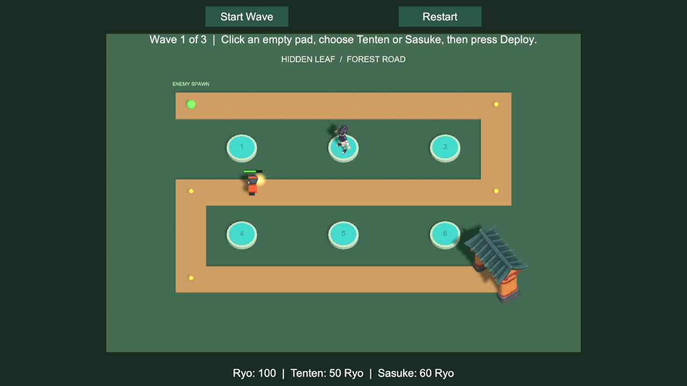
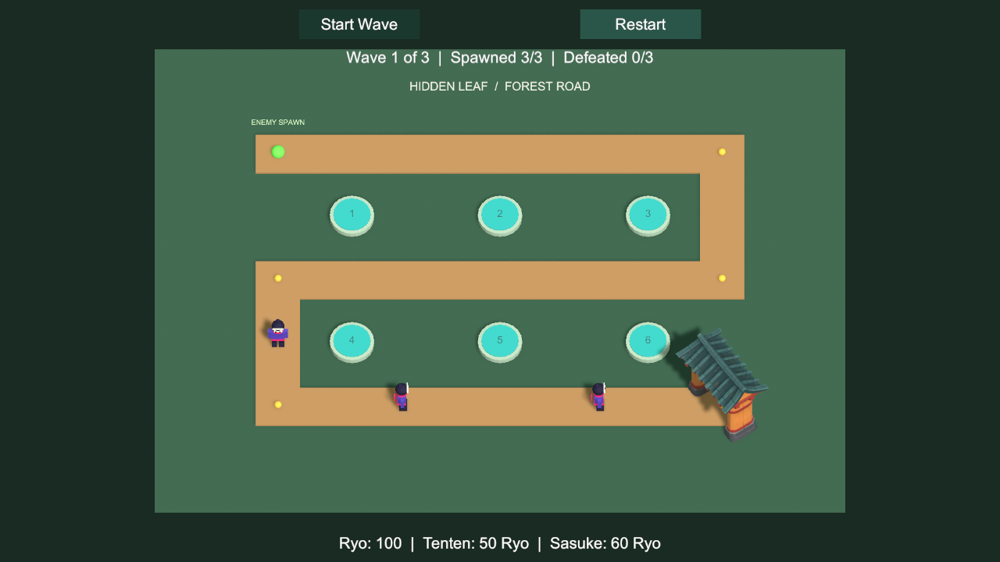

# Tower Defense

Unity project using Unity **6000.6.0f1** and the Universal Render Pipeline (URP).
The current map is **Hidden Leaf Forest Road** in `Assets/Scenes/Main.unity`.
It contains a primitive road, six enemy waypoints, a spawn marker, a textured
Hidden Leaf Gate, stone tower pads with Leaf emblems, and painted-style tree,
rock and grass clusters around the map border. Regular enemies are slim dark-navy ninjas
with **3 HP**; tough enemies are broader armored ninjas with **6 HP**, rounded
burnt-orange shoulder plates, a charcoal outfit and a charcoal helmet with an orange crest.
The ninja is built from Unity primitives under the enemy prefab's `Ninja Visual`
child, with a headband, mask, scarf and boots. Only this model turns to face travel;
the gameplay root, collider, health and movement retain their original behavior.
Both types follow the same waypoints: regular enemies move at **4 units/second**
and tough enemies at **3 units/second**. Both award **15 Ryo** when defeated
(configurable on Round Controller).
The tough prefab overrides the existing Enemy Movement **Movement Speed** setting;
regular enemies retain the base prefab's speed. `Assets/Prefabs/Enemy.prefab`
is the regular enemy; `Assets/Prefabs/ToughEnemy.prefab` is its tough variant.
`EnemyHealth.TakeDamage` subtracts health and removes the enemy at zero.

Enemies have small camera-facing health bars. Bars are hidden at full health;
Regular enemies show a two-thirds bar at 2 HP and a one-third bar at 1 HP. Tough
enemies use the same bar divided by their 6-HP maximum: three Chunin hits take
them through **6 -> 4 -> 2 -> defeated**, showing 4/6 then 2/6. Each bar
follows its enemy and is removed on defeat or Restart. Bars do not block clicks.
To fit a future model, adjust **Vertical Offset** on the **Enemy Health Bar**
component in `Assets/Prefabs/Enemy.prefab` (default: **1.4 world units** above the
ninja's origin; the armored tough variant uses **1.55** to clear its helmet). To prototype a future model,
replace primitives inside `Ninja Visual` while retaining its `EnemyVisualFacing`
component and gameplay-root reference. Keep gameplay collision on the root.

All six pads start empty. The on-screen placement hint reads:
**Click an empty pad, choose Tenten or Sasuke, then press Deploy.**
Before, during, or between waves, left-click a pad to
select it. The highlighted pad shows a shared tower panel and a map preview of
the selected tower's actual attack range. Use the **Tenten** and **Sasuke** buttons
on an empty pad to choose a tower before deploying.

The panel shows the chosen tower's name, attack, and deployment price.
**Deploy** places one tower and charges once; **Cancel** closes the
panel without spending anything. Deploy is disabled with **Not enough Ryo.**
when the balance is below the selected tower's price. Each pad accepts one tower.

| Genin tower | Deploy / sell | Attack | Shot interval | Projectile speed | Range |
| --- | --- | --- | --- | --- | --- |
| Tenten | 50 / 35 Ryo | Kunai: 1 physical damage | 0.9 seconds | 10 units/s | 5.5 |
| Sasuke | 60 / 42 Ryo | Fire Style: Fireball Jutsu, 2 fire damage | 1.6 seconds | 14 units/s | 5.5 |

Sasuke's textured Genin model is **0.5 world units taller** than
Genin Tenten (2.29 versus 1.79 units). His glowing fireball sphere has a short
trail and deals damage to one enemy once on 3D impact.

Both Tenten and Sasuke use **predictive aiming**: the tower solves for the earliest
reachable intercept using the enemy's current position, measured movement velocity,
the actual launch point, and its projectile speed. Kunai and fireballs then fly
**straight without homing**. A target that keeps its current velocity can be hit
on a straight stretch; a turn after launch can still make a shot miss. Towers wait
if no positive intercept within the projectile's lifetime is reachable. Both
projectile types keep their existing damage/speeds and expire after **3 seconds**
if they miss; physical impact still applies damage once.

On an occupied **Genin Tenten** pad, **Upgrade - 60 Ryo** opens a confirmation showing
the cost and the change from **1 to 2 physical damage per hit**. **Confirm Upgrade**
charges 60 Ryo once and upgrades that tower on its existing pad. Cancel spends
nothing; the upgrade is disabled with **Not enough Ryo.** below 60 Ryo.
Chunin Tenten has a blue rank disc beneath her feet and is marked **Highest tier** in the panel.
Her range and fire rate stay the same. Only her newly fired kunai deal 2 damage;
other Genin towers and already airborne kunai retain their original damage.
Chunin's first hit leaves a fresh 3-HP enemy at 1 HP (one-third bar); the second
defeats it. Upgrading is available before, during, and between waves when funds permit.
Sasuke has no upgrade action in this step.

On any occupied pad, choose **Sell for 35 Ryo** for Tenten or **Sell for 42 Ryo**
for Sasuke, then **Confirm Sale** to remove the tower and receive the refund once
(70% of deployment cost). Canceling keeps the tower and balance.
The freed pad can be used again when you can afford deployment. UI clicks do not
select pads behind the panel. Waves keep running while the panel is open.
Enemy rewards immediately refresh Deploy/Upgrade affordability without requiring
reselection or dismissing a pending confirmation. Selling refunds the shown amount once
and frees the pad immediately, including during combat. Victory and Defeat close
the panel, clear the range preview, and block all tower changes. Restart also
clears selection, highlighting, and pending sale/upgrade confirmations.

Place Tenten before clicking **Start Wave**. Forest Road has **five waves**.
Here, **R** means regular (3 HP) and **T** means tough (6 HP):

| Wave | Spawn order | Count (R / T) | Interval |
| --- | --- | --- | --- |
| 1 | R, R, R | 3 (3 / 0) | 2.0 seconds |
| 2 | R, R, T, R, R | 5 (4 / 1) | 1.6 seconds |
| 3 | R, R, T, R, R, T, R | 7 (5 / 2) | 1.2 seconds |
| 4 | T, R, T, T, R, T, R, T, T, R | 10 (4 / 6) | 0.75 seconds |
| 5 | T, R, R, T, R, R, T, T, R, R, T, R, R, T, T, R, R, T, T, T | 20 (10 / 10) | 0.5 seconds |

Select `Round Controller` to edit each wave's **Spawn Order** dropdown list and
**Spawn Interval** in the Inspector. List length determines enemy count. The HUD
shows **Wave 1 of 5** and advances as waves clear.
**Defeat Reward** on the same component sets the per-enemy payout (15 Ryo).
Wave 1 retains its introductory spacing; Waves 2–3 add armor, Wave 4 raises
armored pressure, and Wave 5 sends paired regular ninjas around armored groups.
The final balance pass replaces only the original regular ninja in **slot 19**
with an armored ninja. Waves 1–4, tower stats, speeds, and the 15-Ryo reward
remain unchanged. Regular/armored HP remains **3/6**; the tested 4/8 alternative
was rejected because both equal-cost layouts lost.
Each wave waits for a manual Start Wave click; repeated clicks cannot overlap
waves. Place, sell, or upgrade towers during and between waves using your Ryo.
Each round starts with **100 Ryo**. The HUD shows the balance and both deployment
prices. Early rewards fund a second tower and the first upgrade; reserve Ryo for
additional coverage before Wave 4. Each defeated enemy awards **15 Ryo**
once during the wave. Gate arrivals award nothing. Selecting pads, clicking road
or ground, and canceling panel actions spend nothing.
Each wave clears only after all its enemies have spawned and been defeated.
**Victory** appears only after Wave 5 clears;
any enemy reaching the gate immediately causes **Defeat**. The result stays fixed
and the round stops. **Restart** removes towers, enemies, and projectiles, clears the
pads, clears all upgrades, restores 100 Ryo, and returns to Wave 1 so you can try again.
Select `Assets/Prefabs/TentenTower.prefab` to tune attack range (5.5 units), time between
shots (0.9 seconds), and projectile speed (10 units/second). Each physics hit deals
1 physical damage for Genin or 2 for Chunin. Sasuke's settings and fireball reference
are on `Assets/Prefabs/SasukeTower.prefab`; the projectile is `Assets/Prefabs/Fireball.prefab`.
The original starter `SampleScene` is also included.

Step 26 five-wave winning sequence, using the normal 100-Ryo start and 15-Ryo rewards:

1. Deploy **Genin Tenten on Pad 3** before Wave 1 (100 -> 50 Ryo).
   After the first defeat, deploy **Sasuke on Pad 2** (65 -> 5).
   Wave 1 clears with **35 Ryo**.
2. Start Wave 2. After its second defeat, upgrade **Pad 3 to Chunin**
   (65 -> 5 Ryo). Wave 2 clears with **50 Ryo**.
3. Keep both towers through Wave 3; clearing it leaves **155 Ryo**.
4. Before Wave 4, deploy **Tenten on Pad 1**, then upgrade her to Chunin
   (155 -> 105 -> 45 Ryo). This spreads attacks across the first road and
   returning middle road. Wave 4 clears with **195 Ryo**.
5. Keep those three towers through Wave 5: **Victory, 495 Ryo**, all **45 enemies**
   defeated. Total purchases/upgrades cost **280 Ryo**; no sales were needed.

Step 26 final Play Mode comparison used the same five-wave configuration, normal Ryo,
real-time simulation, pad raycasts, and the existing deployment/upgrade button handlers:

| Setup | Purchase / upgrade timing | Spent | Result | Farthest progress in Wave 5 |
| --- | --- | --- | --- | --- |
| First/return-road coverage | Chunin Pad 3 + Sasuke Pad 2 as above; add Chunin Pad 1 before Wave 4 | 280 | Victory, 495 Ryo | 38.42 / 66 units |
| Middle-road overlap | Start Tenten Pad 2; buy Sasuke Pad 5 after first Wave 1 kill; upgrade Pad 2 after second Wave 2 kill; add Chunin Pad 4 before Wave 4 | 280 | Victory, 495 Ryo | 56.19 / 66 units |

The concentrated setup let enemies travel **17.77 units farther** in Wave 5,
onto the final road, leaving **9.81 units** to the gate versus **27.58** for the
stronger layout. In Wave 4 it reached 37.53 units versus 24.02. Progress measures
the farthest position reached by any enemy along the 66-unit waypoint route.
Both final runs defeated all **45 enemies** before Victory. Purchase/upgrade
timing stayed the same as the initial Step 26 tests.

Alternatives tested before selecting the near-end-only replacement:

| Candidate | Stronger layout | Middle-road overlap |
| --- | --- | --- |
| Original Step 26 Wave 5, 3/6 HP, 9 armored | Victory, 495 Ryo; lead 38.84/66 | Victory, 495 Ryo; lead 55.78/66 |
| Original lineup, **4/8 HP across all five waves** | Defeat in Wave 5, 405 Ryo; lead 66/66 | Defeat in Wave 5, 405 Ryo; lead 66/66 |
| 3/6 HP; replace regulars in slots **10 and 19** | Defeat in Wave 5, 465 Ryo; lead 66/66 | Defeat in Wave 5, 480 Ryo; lead 66/66 |

The 4/8-HP trial applied to both enemy types across all five waves as requested;
each setup defeated 39 enemies before a regular reached the gate. In the
two-replacement trial, the stronger layout defeated 43 enemies and the overlap
layout defeated 44 before an armored ninja with 2 HP escaped. A middle-only
replacement in slot 10 also lost with the stronger layout. The permitted
single-replacement fallback at **slot 19** preserves the stronger layout's win
and leaves the overlap layout with much less room before the gate.

The old **Pad 2 Sasuke / Pad 3 Tenten** setup, upgrading Pad 3 as soon as
Wave 2 rewards permit, previously cleared Waves 1–3 but **lost Wave 4**: a regular
ninja reached the gate with 1 HP. It had spent 170 Ryo and held **290 Ryo** at
Defeat (24 kills). Wave 4 is unchanged in the selected version. Add **Tenten on
Pad 1 and upgrade her before Wave 4** for the tested winning fix above.

Observed spawn order/counts matched the Inspector settings in the final runs;
spacing was approximately 2.0 / 1.6 / 1.2 / 0.75 / 0.5 seconds. No premature clear
or Victory occurred, and repeated Start Wave calls did not overlap waves.
Victory was asserted only at Wave 5 with all 20 of that wave and all 45 overall
defeated. Restart after tested Victory and Defeat restored **Wave 1 of 5**, six
empty pads, 100 Ryo, and no enemies/projectiles. Main was saved and Play Mode
exited. Latest strict compilation and final Console: **0 errors, 0 warnings**.
Tower stats, predictive aiming, six pads, placement controls, rewards, speeds,
and the route were unchanged during these follow-up comparisons.

Historical three-wave Tenten-only sequence (before Step 26; the old 20-Ryo reward):

1. Before Wave 1, deploy Genin on **Pads 2 and 3** (100 -> 0 Ryo), then Start Wave.
   Clearing it leaves **60 Ryo**.
2. Before Wave 2, upgrade **Pad 3** to Chunin and confirm (60 -> 0), then Start
   Wave. Clearing it leaves **100 Ryo**.
3. Before Wave 3, upgrade **Pad 2** to Chunin and confirm (100 -> 40), then Start
   Wave. Leave both Chunin in place; this run won with **180 Ryo** remaining.

Step 17 replayed this complete strategy in Unity Play Mode on predictive-aiming
commit `cc2e09c1`, before changing the hint. All three waves cleared, ending in
**Victory with 180 Ryo** and zero Console errors or warnings. Gameplay stats and
aiming were unchanged. After updating the hint, Game view at 1280x720 showed the
complete sentence without clipping. Mouse-input checks deployed Tenten on Pad 3
for 50 Ryo, then, after Restart, Sasuke on Pad 3 for 60 Ryo. The final Console
had zero errors and one Unity AI Toolkit Account API timeout warning. Play Mode
was exited and Main saved with empty pads.

Step 18 verified the distinct speeds in Main using the actual enemy prefabs and
six waypoints: both completed all four turns and reached the gate. The 66-unit
route took approximately **16.50 seconds** for regular enemies and **22.00 seconds**
for tough enemies. Separate straight-stretch physics checks confirmed Tenten's
kunai and Sasuke's fireball each intercepted both moving types, dealing 1 physical
and 2 fire damage respectively, once per projectile. The same Pads 2/3 strategy
above cleared all three waves again: **Victory with 180 Ryo**. Wave composition,
intervals, tower stats, HP, and predictive aiming were unchanged. Console: zero
errors and two internal Unity JobTempAlloc warnings before the winning run
(allocation lifespan exceeded four frames, followed by a diagnostic-launch
suggestion); no new messages appeared during the winning run. Play Mode was
exited, temporary test observers removed, and Main saved with empty pads.

Verified mixed Wave 1: deploy Tenten on **Pad 3** (100 -> 50 Ryo), select empty
**Pad 2**, choose **Sasuke**, then Start Wave with that panel open. After Tenten's
first defeat reward raises the balance to 70, Deploy becomes enabled. Deploy
Sasuke for 60 (10 left). The remaining enemies were defeated with both towers;
Wave 1 cleared with **50 Ryo**. This also checks deployment during an active wave.

## Imported tower and kunai models

User-supplied Meshy AI character exports now replace both primitive tower visuals.
The Tenten export is organized as `Assets/Art/TentenGenin/Source/Tenten_Genin.fbx`;
the supplied Young Shadow Ninja export is Sasuke at
`Assets/Art/SasukeGenin/Source/Sasuke_Genin.fbx`. Each has matching `_BaseColor`,
`_Normal`, `_Metallic`, `_Roughness`, and `_Emission` PNGs. URP Lit materials live
beside the Source folders and reference their own character's base color, normal,
metallic and emission maps. Normal maps use Normal Map import; metallic/roughness
use linear color space. Roughness sources are retained; smoothness is 0.25.
No individual creator or license file accompanied these supplied exports.

`Assets/Art/TentenKunai/Source/Tenten_Kunai.fbx` replaces the projectile's visual
children. No separate kunai textures were supplied, so it uses a URP steel material.
The source blade's +Y tip is rotated to projectile +Z, with a total length of 0.85
units. Existing Rigidbody, trigger collider, impact damage and three-second
lifetime are unchanged. Imported triangle counts: Tenten **84,084**, Sasuke
**121,766**, kunai **640**. No mesh reduction or source-file changes were made.

The original unimported exports were also renamed locally to `TentenGenin/`,
`SasukeGenin/`, and `Tenten_Kunai.fbx` at the project root, with matching clear
texture filenames; these local copies are not required by Unity. The imported
sources under `Assets/Art/` preserve all source bytes. Unity metadata accompanies
all imported files. The tower prefab roots retain their firing settings and
launch points; only visual children and Tenten's upgrade-accent reference changed.
Tenten is 1.79 units tall; Sasuke is 2.29. Their feet sit on the pad surface.
Tenten's original upgrade logic changes a red rank disc to blue while preserving
the textured model. Neither imported character adds colliders.

Play Mode checks passed with both towers deployed through the normal pad/panel
controls and normal Ryo. Tenten's kunai and Sasuke's fireball each hit moving
regular and tough enemies once for 1 physical / 2 fire damage. The mixed Wave 1
cleared with 50 Ryo; an earned Wave 2 reward enabled the 60-Ryo Chunin upgrade,
which left 10 Ryo and changed the rank disc to blue. Wave 2 then cleared with
90 Ryo. Inspected Game view for scale, facing, materials and the upgrade accent.
Final Console: **0 errors, 0 warnings**. Main was saved with empty pads and Play
Mode exited.

Follow-up full three-wave Play Mode test also passed using only Tenten on Pad 3
and Sasuke on Pad 2: **Victory, 230 Ryo**. Deploy Tenten before Wave 1, deploy
Sasuke after the first kill enables her 60-Ryo cost, then upgrade Tenten during
Wave 2 after its first kill enables the 60-Ryo upgrade. Wave 1 cleared with 50
Ryo, Wave 2 with 90, and all seven Wave 3 enemies were defeated. The blue rank
accent was readable from the gameplay camera; the kunai blade axis matched its
straight flight direction, and both physical and fire impacts were observed.
Console during this run: **0 errors, 0 warnings**. FBXs, textures, materials,
prefab references and matching metadata were checked for submission.

## Sasuke fireball polish (Step 22)

Fireballs now have a bright yellow-white core, an orange halo, a short hot trail
and drifting ember particles. A confirmed enemy impact creates a brief flash
with 16 sparks; the burst fades and removes itself automatically. Effects add
no colliders or damage. The existing 0.35-radius trigger, 14-unit/second speed,
2 fire damage, firing interval, range and straight predictive aiming are unchanged.

Play Mode checks from the overhead camera confirmed visible flight and impact
effects. Single shots took a moving tough enemy from 6 to 4 HP and a moving
regular enemy with overlapping colliders from 3 to 1 HP. Each shot caused one
burst and one damage application; health stayed unchanged afterward, and each
burst was gone within 0.55 seconds. A normal mixed Tenten/Sasuke Wave 1 cleared
with 50 Ryo, with both physical and fire impacts observed. Console during these
checks: **0 errors, 0 warnings**. Full three-wave play was not repeated for this
visual polish.

## Shared enemy styling (Step 23)

Both enemy prefabs now share rounded garment shapes, steel headbands, warm skin
details, linen forearm wraps and sandals, using URP Lit materials in
`Assets/Art/EnemyNinjas/`. This palette and their compact proportions sit alongside
the imported Tenten and Sasuke models. The regular ninja is slim and dark navy
with a muted burgundy sash. The tough ninja has a wider charcoal torso, rounded
burnt-orange shoulder armor with small steel rivets, and a helmet with an orange
crest. These changes reuse the existing `Ninja Visual` children and facing logic.

Only visual children changed. Root colliders, transforms, movement, health,
20-Ryo rewards and wave configuration are preserved: regular 3 HP / 4 units per
second, tough 6 HP / 3 units per second. Health-bar offsets remain 1.4 and 1.55;
visual children have no colliders.

In Play Mode, Wave 2 showed both enemy types together and clearly distinguishable
from the gameplay camera, with a readable damaged armored health bar. Natural
Tenten and Sasuke impacts updated regular bars to 2/3 and 1/3 and tough bars to
4/6 and 2/6, with camera-facing orientation maintained. The normal-budget mixed
three-wave strategy finished **Victory with 230 Ryo**. Console during verification:
**0 errors, 0 warnings**. Main saved with empty pads and Play Mode exited. Final Editor Console: **0 errors, 1 warning** from Unity AI Toolkit
(Account API unavailable within 30 seconds); no gameplay warnings were observed.

## Forest Road scenery and stone pads (Step 24)

Eight border clusters contain 20 faceted, layered trees, 24 rocks and 56 grass
tufts in muted jade, moss and warm stone tones that complement the painted gate.
Shared meshes, materials and a softly mottled stone texture live in
`Assets/Art/ForestRoad/`. Scenery has no colliders and uses Ignore Raycast.

The six existing pad surfaces are now weathered stone with subtle spiral Leaf
emblems and readable numbers. The existing gold selection ring and range preview
remain unchanged. Original pad colliders, positions and surface heights are
preserved, so towers still sit at the same height. Camera, route, endpoint defeat
logic and pad input/deployment code are unchanged.

Play Mode native mouse clicks selected each of Pads 1–6, displayed its gold
highlight, and canceled without spending Ryo or deploying a tower. Temporary
in-memory Editor focus routing was restored afterward. A mesh-ray check sampled
578 pad/route/body/health-bar sightlines with no new scenery intersections.
Wave 3 Game view showed unobstructed enemies and readable health bars; the normal
mixed Tenten/Sasuke strategy finished **Victory with 230 Ryo**. Console during
verification and cleanup: **0 errors, 0 warnings**. Main saved with empty pads and
Play Mode exited. Review screenshots remain local and uncommitted.

## Audio and credits (Step 25)

Background music is **Calm Track (loopable version)** by **pmiller**, released
under **CC0 1.0 Universal** on [OpenGameArt](https://opengameart.org/content/calm-track).
The original `calm_track-loop.ogg` is included unchanged as
`Assets/Audio/Music/ForestCalmLoop.ogg`. See
[audio credits](Assets/Audio/CREDITS.md) and the included
[CC0 license](Assets/Audio/LICENSE-CC0.txt).

The five effects in `Assets/Audio/SFX/` are original synthesized sounds created
for this project and dedicated under CC0, without third-party samples: a short
metallic kunai swish, a lower fireball whoosh, and separate wave-start, Victory
and Defeat note cues. Attacks sound when a projectile is actually fired. Round
cues follow accepted wave starts and guarded outcome transitions, so rejected
button calls do not replay them.

The scene's `Game Audio` object has separate 2D music, attack and round-cue
sources. Volumes are 0.12 / 0.55 / 0.8, keeping music below the effects. Restart
stops old effects/cues and keeps the same single music loop; the manager does not
spawn persistent audio objects. Adjust the three AudioSource volumes in the
Inspector to tune the mix.

Play Mode verification observed the real 249.237-second music clip wrap back to
the start after seeking near its end, with continuous playback and nonzero live
listener output. The mixed three-wave run won with 230 Ryo, triggering 23 kunai
and 14 fireball sounds, three accepted wave-start cues and one Victory cue.
An empty-pad run produced one more wave-start cue and exactly one Defeat cue.
Repeated rejected start/end calls did not replay cues; repeated Restart after
both outcomes kept one music loop on the same source. A fresh Play Mode startup
and three further Restarts also kept one loop, with attack/cue sources stopped.
Final Console: **0 errors, 0 warnings**. Main saved and Play Mode exited.
After verification, music gain was raised from 0.04 to 0.12 at the user's request;
the other volumes and playback logic are unchanged.

## Final Play Mode verification (Step 20)

The tough variant reuses the regular `Ninja Visual` child, adding broad
burnt-orange shoulder plates and a steel helmet over a charcoal outfit. Its
original capsule renderer is disabled; the gameplay capsule collider is retained.
The visual primitives have no colliders. The original Step 20 materials remain in
`Assets/Materials/ArmoredNinja/`; Step 23 uses the shared palette described above.
Geometry and material overrides are saved in
`Assets/Prefabs/ToughEnemy.prefab`. Movement, HP, rewards, wave placement and
predictive aiming are unchanged.

The documented Pads 2/3 Tenten strategy cleared all three waves with the armored
ninja and textured gate: **Victory, 180 Ryo**. Wave 1 left 60 Ryo; upgrading Pad 3
before Wave 2 spent 60, Wave 2 left 100, and upgrading Pad 2 before Wave 3 left 40.
Real kunai impacts updated armored health bars, including 4/6 and 2/6; the raised
bar remained readable above the helmet. Violet and armored enemies are distinct
from the unchanged gameplay camera.

Empty pads caused **Defeat** when an enemy reached Point5, with no Ryo reward.
Restart after both Victory and Defeat restored Wave 1, 100 Ryo, six empty pads,
no enemies/projectiles and no pending selection; the textured gate remained.
The complete placement hint was readable at 1280x720. Both tower choices deployed;
active-wave checks passed deployment, canceling/confirming sales, 35/42-Ryo refunds,
immediate pad reuse, and canceling/confirming the 60-Ryo Chunin upgrade. Confirmed
transactions occurred once. Waves continued with the panel open and kill rewards
updated affordability. Mouse-input deployment was also checked using temporary
in-memory Editor focus routing, then the original default input settings restored.
The active-wave transactions and empty-pad Defeat/Restart checks were rerun after
restoration. Final Console: **0 errors, 0 warnings**. Main was saved with empty
pads and Play Mode exited.

Final checks run in Unity 6000.6.0f1 Play Mode; no standalone player build was made.
Gate FBX/textures/material and armor assets have their `.meta` files. The renamed
gate sources retain their GUIDs and the original source files. The source renames,
armor assets and their metadata are included together.

## Hidden Leaf Gate asset (Step 19a)

The gate uses the user-supplied Meshy AI export named
`HiddenLeafGate.fbx` and its accompanying
textures named `HiddenLeafGate_BaseColor`, `HiddenLeafGate_Normal`,
`HiddenLeafGate_Metallic`, and `HiddenLeafGate_Roughness`, imported under
`Assets/Art/HiddenLeafGate/Source/`. Attribution is to
the supplied Meshy AI export; no individual creator or license file was provided
with the source folder. The original FBX and all four texture files are preserved
byte-for-byte; no reduced mesh was used. Unity imports **200,748 triangles**
(112,996 vertices).

`Hidden Leaf Gate.mat` uses the project's **URP Lit** shader with the supplied
base-color and normal textures. The normal texture is imported as a Normal Map.
Metallic and roughness source images are retained; this material uses constant
metallic 0 and smoothness 0.25. The visual is centered over Point5, rotated
55 degrees around Y and scaled 1.9 on its parent so the arch spans the final road
and the roof is readable from the unchanged gameplay camera. The primitive gate
was removed; the new visual has no colliders and does not change waypoints or
defeat logic.

In Play Mode, Wave 1 with six empty pads reached **Defeat** when the first enemy
arrived at `(18, 0.9, -12)`. Restart restored Wave 1, 100 Ryo, six empty pads and
zero enemies/projectiles; the textured gate stayed in place. At 1280x720, both
the roof and approaching enemies were visible, with no missing textures.
Final Console: **0 errors, 0 warnings**. Main was saved and Play Mode exited.

## Open and run

1. Install Unity Hub and Unity Editor **6000.6.0f1**. The exact version is also
   recorded in `ProjectSettings/ProjectVersion.txt`.
2. Clone this repository, or download its ZIP from GitHub and extract it.
3. In Unity Hub, choose **Add project from disk** and select the folder containing
   `Assets`, `Packages`, and `ProjectSettings`.
4. Open the project. Allow Unity to download packages and finish importing assets
   and compiling scripts. Internet access is needed for the first package restore.
5. Open `Assets/Scenes/Main.unity` and press **Play** in the Editor.

Unity Hub may ask you to sign in and activate an appropriate Unity license.
Codex, Unity MCP, and the Unity CLI are not required to open or run the scene.
This repository contains the Unity source project, not a standalone executable.

## Files included in Git

Keep `Assets/` and its `.meta` files, `Packages/manifest.json`,
`Packages/packages-lock.json`, and `ProjectSettings/` together. They preserve asset
references, package versions, scene configuration, and the Editor version.

The standard Unity `.gitignore` excludes generated folders such as `Library/`,
`Temp/`, `Logs/`, and `UserSettings/`, plus generated IDE project files. Unity
recreates these locally when the project opens; they are not needed in a download.

Before committing, save changes in Unity and check the Console for compilation
errors. Review the files being committed so generated files stay out of Git.
